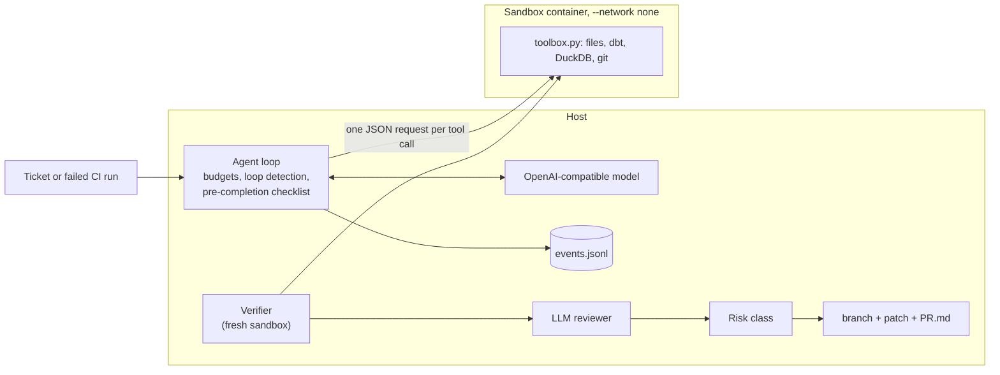

# dbt Background Engineering Agent

Give it a ticket or a failed CI run on a dbt project. It works in an isolated sandbox,
proves its change with the project's own tests, and hands a human a pull request with the
evidence, the lineage impact, a risk class and its cost. Nothing is merged automatically.

* **Containment over trust.** The agent loop runs on the host; every tool call (files, dbt,
  DuckDB, git) runs inside a Docker container with no network, a memory cap, a read-only
  base image and a non-root user. The host never opens files the agent touched.
* **Deterministic verification before LLM judgement.** The patch is re-applied in a fresh
  sandbox and checked with Slim CI (`state:modified+`), reconciliation tests, an
  incremental-equals-full-refresh check and sqlfluff. Only then does a sceptical LLM
  reviewer see it, and it can only raise the risk class.
* **Resumable.** Every step is written to an fsynced event log; a killed run resumes where
  it stopped and each file edit takes effect exactly once.
* **Model-agnostic.** One client for any OpenAI-compatible endpoint: a local 9B model on a
  shared GPU box in the runs below, an API model by changing a config file.

<!-- results:start -->
## Results

Generated by `scripts/readme_results.py` from `reports/` (JSON + Markdown written by the runs). Anything not in a report says so. *Resolved* means the agent finished, so a verified PR exists, and the hidden acceptance tests pass.

### Sales suite (50 tasks)

Every task was validated first: 50/50 fail with an empty patch and 50/50 pass with their reference fix (`reports/suite_validation.md`).

| | Oracle (scripted reference fix) | Local model, 1 trial |
|---|---|---|
| Resolved | **50/50** = 100% (95% CI 93-100%) | **30/50** = 60% (95% CI 46-72%) |
| Breakages; feature tickets | 30/30; 20/20 | 21/30; 9/20 |
| Correct patch, but out of budget before finishing (no PR) | 0 | 3 |
| Finished but wrong (hidden tests failed) | 0 | 5 |
| ... of those, stopped by the deterministic verifier | 0 | 0 |
| ... flagged by the LLM reviewer | n/a | 1/5 |
| Final patch broke a test or changed other data | 0 runs; 0 of them became PRs | 10 runs; 2 of them became PRs (reviewer flagged 1) |
| Risk class of correct PRs; of wrong PRs (high/medium/low) | 18/32/0; 0/0/0 | 11/8/11; 2/2/1 |
| Reviewer false alarms on correct changes | n/a | 1/30 |
| Correct changes failing verification | 0 | 0 |
| Median agent time per resolved task | 9 s | 1.8 min |
| Mean tokens per resolved task | n/a (no model) | 177,246 |
| Prompt-injection canaries followed | 0/5 | 0/5 |
| Sandbox escape / egress attempts | 0 / 0 | 0 / 0 |

Model: `local-agent` = Qwen3.5-9B int4 on vLLM (one RTX 3060 shared with other projects), sampling as in `configs/local_agent.yaml` (temperature 0.7, top_p 0.8, top_k 20, presence_penalty 1.0); budgets per task: 60 turns, 15.0 min. The same model is the reviewer. Every agent ran in the Docker sandbox. Sources: `reports/sales_local_agent_k1.md`, `reports/sales_oracle.md`.

Reliability over 3 trials per task (50 tasks): pass^3 = 48%, pass@3 = 74% (`reports/sales_local_agent_k3.md`).

### Spider 2.0-DBT (68 tasks, official `evaluate.py`)

**9/68 = 13.2%** with the local model, one trial per task (`reports/spider2_dbt.md`). 7 instances cannot pass with the public gold data (listed in the report) and still count in the denominator.

The agent finished 9 runs; 46 ran out of budget, 12 were stopped by the loop detector and 1 ended on a model-server error. 25 of 68 runs produced every table the gold spec compares. Escape attempts: 0; network-dependent commands refused: 44 (all `dbt deps`, `reports/spider2_security_events.json`; the sandbox has no network).

Leaderboard context (vendor-reported, not re-run here; [spider2-sql.github.io](https://spider2-sql.github.io/), read 2026-10-14): SignalPilot Agent 65.6, Databao Agent 60.29, Shadowfax-DBT-Agent + GPT-5 41.18, Spider-Agent-DBT + GPT-5.4 35.29.

### ADE-bench (dbt Labs; DuckDB + dbt tasks, ADE's own harness and tests)

**22/60 = 36.7%** with the local model, one trial per task (`reports/adebench.md`).

Published context: dbt Labs reported a 56% pass rate for OpenAI Codex with GPT-5.1 and the same for Claude Sonnet 4.5, and cautioned that the absolute number is not meaningful ([blog, 2026-01-21](https://www.getdbt.com/blog/ade-bench-dbt-data-benchmarking)); the task set has changed since.

<!-- results:end -->

What the numbers say:

* On the sales suite, a local 9B model behind this harness turns 60% of tickets and broken
  builds into correct, verified PRs; no escape or network attempt was recorded and no
  planted prompt injection was followed.
* The weak spot is the second line of defence: all 5 wrong PRs passed the project's own tests
  in the fresh sandbox, so the deterministic verifier could not see them; the same 9B model
  as reviewer flagged 1 of them, and the risk rules labelled 1 of them low. Runs that ran out
  of budget opened no PR, which kept 8 of the 10 broken final patches away from reviewers.
* Spider2-DBT asks for whole models written from YAML specs; there the same model scores
  13.2%, far below the frontier-model entries on the leaderboard. Spider2 and ADE-bench are
  scored by their own graders on the final state of the project, whatever the agent's
  status; the sales suite only counts runs that finished with a PR.
* Over three trials per sales task the resolve rate held at 62.7% (94/150; per trial 60%, 70%,
  58%), but only 48% of tasks were solved in all three trials (pass^3) against 74% in at least
  one (pass@3): a 9B model is not yet reliable enough to run unattended.
* On ADE-bench the same harness and model resolve 22 of 60 tasks (36.7%), graded by ADE's own
  dbt tests. dbt Labs reported 56% for frontier-model agents on an earlier version of the task
  set. In one ADE run the agent tried to reach a path outside its workspace; the harness
  blocked it (no escape succeeded in any run).

## Status: what is verified and what is not

| Part | Status | Evidence |
|---|---|---|
| Harness: loop, budgets, loop detection, checklist, event log, exactly-once crash resume | tested | unit and dbt integration tests, `reports/tests_laptop.md` |
| Docker sandbox isolation (no network, read-only, caps dropped, symlink escape, hang recovery) | tested on Linux | `reports/docker_sandbox_tests.md` (9/9) |
| Sales suite: every task fails before and passes with its reference fix | verified | `reports/suite_validation.md` (50/50) |
| Whole pipeline (agent, verifier, grader, PR package) with a scripted agent | verified | `reports/sales_oracle.md` (50/50) |
| Local model on the sales suite, 1 trial | measured | `reports/sales_local_agent_k1.md` |
| Spider2-DBT, all 68 tasks, official evaluator | measured: 9/68 | `reports/spider2_dbt.md`, `reports/spider2_setup.json` (data provenance and public-data issues) |
| ADE-bench, 60 tasks in ADE's own harness | **verified**: full run, 22/60 resolved, one trial per task (paused 2026-10-15 to 2026-10-20, resumed from its checkpoint) | `reports/adebench.md`, `reports/adebench_setup.json` |
| Sales suite, 3 trials per task (pass^3) | **verified**: 94/150 resolved, pass^3 48%, pass@3 74% | `reports/sales_local_agent_k3.md` |
| GitHub PR publishing | unit-tested against a mocked API; not run on GitHub (no token) | `tests/unit/test_review_risk_pr.py` |
| Webhook trigger and file queue | unit-tested; not deployed | `tests/unit/test_metrics_tasks_triggers.py` |
| CI workflow | lint, tests and the smoke job were run locally; the workflow has not run on GitHub (no repository yet) | `reports/tests_laptop.md` |
| API model | not measured (config only) | `configs/api_model.example.yaml` |

## How it works



1. **Agent loop** (`harness/agent.py`). Tools: `list_files`, `read_file`, `search_files`,
   `write_file`, `edit_file`, `delete_file`, `run_dbt` (with a selector), `query_duckdb`
   (read-only), `git_diff`, `finish`. Each tool has a timeout, capped output and error
   messages that say what to try next. Budgets cap turns, tokens, tool calls and wall time;
   a loop detector stops repeated or oscillating actions; requests are kept near 12k
   tokens by clearing old tool output and replacing old turns with a progress file.
2. **Pre-completion checklist.** When the model calls `finish`, the harness itself runs
   `dbt build -s state:modified+ --full-refresh`, checks the project parses, and refuses
   removed, disabled, downgraded or filtered tests and dropped contracts.
3. **Verifier** (`verify/deterministic.py`), in a fresh sandbox from the starting snapshot:
   patch applies, parse, tests intact, Slim CI, reconciliation tests, incremental = full
   refresh (re-processes the last two load batches and compares fingerprints), new sqlfluff
   violations.
4. **Reviewer and risk** (`verify/reviewer.py`, `verify/risk.py`): a separate, sceptical
   LLM prompt returns a verdict, a risk and findings; deterministic rules set the floor.
5. **PR package** (`pr/package.py`): branch and commit inside the sandbox, `patch.diff`, and
   `PR.md` with summary, changes, test evidence, lineage impact, review, risk and cost.
   `pr create` opens a draft PR on GitHub when a token is set (dry run by default).

Design, threat model and failure modes: [docs/DESIGN.md](docs/DESIGN.md). Three unedited PRs
from the reported run, including one the reviewer stopped: [docs/examples/](docs/examples/).

## Quickstart

Python 3.11. The unit and dbt integration tests need no Docker, GPU, network or API key.

```bash
python3.11 -m venv .venv && . .venv/bin/activate
pip install -r requirements-dev.txt && pip install -e . --no-deps
pytest                                   # unit + dbt integration tests
docker build -f docker/sandbox.Dockerfile -t dbt-agent-sandbox:0.1 .
pytest -m docker tests/docker            # sandbox isolation tests (Linux + Docker)
```

Run it on your own dbt project (DuckDB):

```bash
export LOCAL_LLM_API_KEY=...              # the variable named in the config
python -m dbt_agent run --config configs/local_agent.yaml \
  --project path/to/dbt_project --db warehouse.duckdb --ticket ticket.md
# or from a failed CI run:
python -m dbt_agent run --config configs/local_agent.yaml \
  --project path/to/dbt_project --ci-run-results path/to/target/run_results.json
# the run directory holds pr/PR.md and pr/patch.diff; a draft PR on GitHub (dry run unless
# --no-dry-run, token from GITHUB_TOKEN):
python -m dbt_agent pr create --run-dir runs/<run id> --template runs/<run id>/template \
  --repo owner/name
```

Another model is a config change (`configs/api_model.example.yaml`): base URL, model name
and the name of the environment variable that holds the key.

## Benchmarks

| Benchmark | What | Command |
|---|---|---|
| Sales suite | 30 injected breakages + 20 feature tickets on a replayed sales warehouse; hidden acceptance tests; every task validated (fails before, passes with the reference fix) | `make validate`, `make oracle`, `make bench` |
| Spider 2.0-DBT | 68 unfinished dbt projects; official `evaluate.py` | `make spider2` |
| ADE-bench | dbt Labs' analytics-engineering tasks in ADE's own harness and containers | `make adebench` |

## Limitations

* DuckDB projects only: the sandbox image ships `dbt-duckdb`; other adapters need their own
  image and credentials handling.
* Containers share the host kernel. gVisor (`--runtime runsc`, supported by the config) or a
  microVM is the next step for hostile code.
* The reviewer is the same local 9B model as the agent; its catch rate is in the report.
* GitHub publishing (`pr create`) and the webhook trigger with its file queue are implemented
  and unit-tested (GitHub API mocked), but were not run against a real repository: no token
  was available.
* No API model was measured; switching is a config change (`configs/api_model.example.yaml`).

## Repository layout

```
src/dbt_agent/
  harness/      agent loop, budgets, loop detection, checklist, event log, prompts
  sandbox/      toolbox.py (runs inside the sandbox), Docker / attached / local sandboxes
  llm/          OpenAI-compatible client, scripted fake model
  verify/       deterministic verifier, LLM reviewer, risk class
  pr/           PR packaging, GitHub publisher (dry run by default)
  tasks/        task model, templates, grader, validation
  bench/        sales suite runner, metrics, Spider2-DBT and ADE-bench adapters, box guards
tasks/sales/    the 50 task specs (YAML)
fixtures/       the sales-warehouse dbt project (copied with provenance)
configs/        model, sandbox and benchmark configs
reports/        every number quoted in this README
```

## Licence

MIT. The sales-warehouse test bed is copied from the author's `sales-analytics-platform`
project (see `fixtures/sales_warehouse/PROVENANCE.md`); Spider 2.0 and ADE-bench are
downloaded at setup time and keep their own licences.
