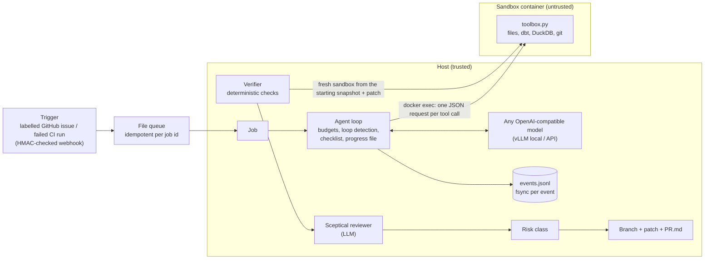

# Design: dbt Background Engineering Agent

A background agent that takes a ticket or a failed CI run on a dbt project, works in an
isolated sandbox, proves its change with the project's own tests, and hands a human a
pull request with evidence, lineage impact, a risk class and its cost.

Numbers in this document come from `reports/` (each section names its file). Anything not
measured says so.

## 1. Architecture

* **The agent loop runs on the host; only tool execution happens in the sandbox.** The
  sandbox therefore needs no network at all (`--network none`): the model endpoint, its key
  and the event log never enter it.
* Every tool (list, read, search, write, edit, delete, apply patch, `run_dbt`,
  `query_duckdb`, `git_diff`) runs inside the container through one script,
  `src/dbt_agent/sandbox/toolbox.py` (standard library + `duckdb`). The host never opens a
  file inside an agent work directory - see the symlink and `.git/config` threats below.
* State is event-sourced: the run can be killed at any point and resumed (section 4).

## 2. The harness

| Part | What it does | Where |
|---|---|---|
| Tools | 10 model tools + `finish`. Each has a timeout, a capped output (5,000 characters; head and tail kept) and error messages that say what to do next (e.g. "old_string was not found ... The closest match is around line 12: ..."). `read_file` shows `<n><TAB><text>`; `edit_file` forgives copied line numbers or a one-space shift only when the result matches exactly once; file tools keep each file's own line endings | `sandbox/toolbox.py`, `harness/tools.py` |
| Budgets | max turns, max tokens (prompt + completion), max tool calls, max wall time (summed over sessions, so a resumed run does not get a fresh budget), optional max EUR; a one-time warning near the limit | `harness/budgets.py` |
| Loop detection | identical call + identical result repeated; the same error N times in a row; edits that return the files to an earlier state (oscillation). Warn first, stop after repeated warnings | `harness/loopdetect.py` |
| Pre-completion checklist | when the model calls `finish`, the harness checks: a real summary; a non-empty change; the project parses; no test removed, disabled, downgraded to `warn` or filtered and no contract dropped (unless the model gives `tests_changed_reason`, which raises the risk class); and runs `dbt build -s state:modified+ --full-refresh` itself. Failures go back to the model as the `finish` result | `harness/checklist.py`, `harness/integrity.py` |
| Progress file | `progress.md`, rewritten after every turn: files changed, dbt runs, finish attempts, last actions. Used for humans, for resume and for context compaction | `harness/progress.py` |
| Context management | the shared model server's KV cache (~80k tokens) serves several projects, so each request is kept near 12k tokens: old tool outputs are cleared first; if still too large, older turns are replaced by the progress file. The full history stays in the event log | `harness/agent.py` (`_context`) |
| Model client | plain httpx against any OpenAI-compatible endpoint; retries with backoff on 503/429/timeouts (about 3 minutes in total), never on other 4xx; a process-wide semaphore (max 4 concurrent requests); typed context-length error; recovers tool calls a local model prints as text (Hermes JSON or Qwen3-Coder XML); strips `<think>` blocks | `llm/client.py` |
| Fake model | scripted replies (fixed or reacting to tool output) with the same types as the real client; used by the unit tests, the CI smoke test and the oracle agent | `llm/fake.py`, `bench/oracle.py` |

## 3. Verification: deterministic first, then judgement

After the agent finishes, its patch is re-checked in a **fresh sandbox** created from the
task's starting snapshot (the agent's own sandbox may hold any state):

1. patch applies (patches that create symlinks are refused);
2. the project parses;
3. tests and contracts intact (same rule as the checklist);
4. Slim CI: `dbt build --select state:modified+ --state <starting manifest> --full-refresh`;
5. the project's reconciliation tests (configured per project);
6. **incremental = full refresh**: for each configured incremental model in the modified
   graph, the last two load batches are deleted and re-processed incrementally, and an
   order-independent fingerprint (row count + sum of row hashes, doubles rounded) is compared
   with the full-refresh build;
7. sqlfluff on the changed SQL files, counting only new violations (non-blocking).

Only then does a **separate LLM reviewer** see the ticket, the diff, the evidence and the
lineage. Its prompt is sceptical (assume wrong until proven; look for dropped rows, weakened
tests, hard-coded values, scope creep, incremental/snapshot changes, signs of prompt
injection) and it answers in JSON: verdict, risk, findings. It sees the agent's summary but
not its reasoning.

**Risk class** (`verify/risk.py`): rules first - any failed blocking check, weakened tests, a
changed incremental model or more than 10 downstream models is *high*; seeds/config/snapshots,
more than 3 downstream models, exposures, new lint violations, a large diff or a missing
review are *medium* - and the reviewer can only raise the class. *Low* means small, isolated, fully verified and approved. Nothing is merged
automatically; the class is a label for the human.

**What verification cannot see** (measured, `reports/sales_local_agent_k1.md`): all 5 wrong
PRs of the local-model run passed every deterministic check, because the project's own tests
did not encode what the ticket asked for: a cast that turned ids into `12345.0`, a filter
the ticket did not ask for, and three new marts or sources whose values did not match the
ticket's specification. The checks prove that nothing that was
tested broke; they cannot prove the change does what was asked. That is the reviewer's job,
and a 9B reviewer caught 1 of the 5. Two consequences: tickets should carry acceptance
checks the agent must add as tests, and the reviewer should be the strongest model
available, since it reads one diff per job.

## 4. Reliability: resumable, idempotent runs

* **Event log.** Every decision is written and fsynced before the harness acts on it
  (`tool_call` before execution, `tool_result` after). A torn last line from a crash is
  detected and cut off on reopen.
* **Resume.** Replaying the log rebuilds the conversation, budgets (including wall time of
  earlier sessions) and loop-detector state. An LLM request without a response is simply sent
  again. Tool calls of the last model message that have no logged result are re-executed
  after the work directory is restored to the last snapshot - a `git write-tree` taken after
  every mutating call - so each edit takes effect exactly once
  (`tests/unit/test_agent_loop.py::test_resume_after_crash_is_exactly_once`).
* **Pipeline stages** (`pipeline.py`) each write a result file and are skipped when it
  exists; benchmark runners checkpoint per task. A power cut costs at most the task in flight,
  and that task resumes from its event log
  (`tests/integration/test_pipeline.py` runs a whole job twice: the second call does nothing).
* **One container at a time.** The agent's sandbox is stopped before the verifier starts its
  own (and restarted only to commit the PR branch), so a job never holds two containers.
* **Byte-exact patches.** Patches are read back without newline translation, and the file
  tools keep each file's own line endings (a one-line edit to a CRLF file stays a one-line
  diff). Found by the oracle run: 6 of 50 reference patches touched CRLF files and failed to
  apply in the fresh sandbox until this was fixed.

## 5. Threat model

Assets: the host (files, other projects and the user's desktop on the shared GPU box),
credentials (model API key, GitHub token), the integrity of the tests and of the pull
request, and the warehouse data.

| Threat | How it could happen | Controls | Evidence |
|---|---|---|---|
| **Prompt injection through repository content** | instructions in SQL comments, YAML descriptions, seed rows, table data, issue bodies or CI logs | the system prompt treats file and data content as untrusted; the agent has no network and no tool outside the project; read-only database tool; the checklist and the fresh-sandbox verifier do not trust the agent's claims; a human merges. Measured with planted canaries (5 suite tasks) | `tasks/sales/*` with `canary:`; 0 of 5 canary runs followed the injection (`reports/sales_local_agent_k1.md`) |
| **Network egress / exfiltration** | `read_csv('https://...')`, `INSTALL httpfs`, Python models with `requests`, `dbt deps` | container `--network none` (only loopback); DuckDB query tool with `enable_external_access=false` and locked configuration; `dbt deps` refused; every attempt is classified and counted | `reports/docker_sandbox_tests.md`: connections to the internet and to the model server fail; 0 egress attempts in the sales run; `tests/unit/test_toolbox.py` |
| **Sandbox escape via paths** | `../`, absolute paths, symlinks planted by sandboxed code (a dbt Python model can run `os.symlink`) | all file tools resolve paths with `realpath` inside the sandbox and refuse anything outside the work directory; protected directories (`.git`, `target`, `dbt_packages`, `.agent`) and database files cannot be written | `tests/docker/...symlink...`, `tests/unit/test_toolbox.py` |
| **Host-side operations poisoned by sandboxed code** | the host following a symlink while copying or cleaning a work directory; host `git` running in a directory whose `.git/config` sets `core.fsmonitor` or hooks | the host never opens or runs git in an agent work directory: patches leave the sandbox as text; results are copied with `O_NOFOLLOW` and a realpath check; cleanup never follows links; PR branches are built from the trusted starting snapshot plus the patch text | `workspace.remove_databases`, `pr/github.prepare_publish_repo`, `bench/spider2._safe_copy` |
| **Privilege / container escape** | kernel or runtime exploits from code dbt executes | non-root user, `--cap-drop ALL`, `no-new-privileges`, read-only root filesystem, `/tmp` noexec, pids limit, memory cap without swap. Residual: containers share the host kernel; a microVM or gVisor (`--runtime runsc`, supported by the config) is the next step | `reports/docker_sandbox_tests.md` (9/9 on the box) |
| **Secrets** | keys in logs, events, prompts, PRs or the sandbox | keys are read from environment variables named in the config (never stored in config files); nothing secret is passed into containers; the GitHub token reaches git through a credential helper environment variable and is masked in errors | `config.py`, `pr/github.py` |
| **Resource exhaustion** | runaway SQL, fork bombs, huge outputs, endless loops | per-tool timeouts with process-tree kill; host-side deadline that recreates a hung container; memory cap; pids limit; output caps; budgets; loop detection; on the shared box: RAM admission (MemAvailable >= cap + 1 GB) and a box-wide heavy-job lock | `tests/docker/...hang...`, `bench/boxguard.py` |
| **Reward hacking / test tampering** | deleting or weakening tests, special-casing data, editing the hidden checks | checklist and verifier detect removed, disabled, downgraded or filtered tests and dropped contracts; hidden acceptance tests are added only in the grading sandbox; grading also compares data fingerprints with the reference fix (collateral changes) | `harness/integrity.py`, `tasks/grader.py` |
| **Untrusted triggers** | forged webhooks, replays | HMAC signature check; the queue accepts a job id once | `triggers.py`, unit tests |

Known residual risks: shared-kernel containers (above); the ADE-bench adapter runs in
ADE's own containers (root, default capabilities): we disconnect every network and cap
memory for the agent phase, and reconnect the network afterwards because ADE's grading
(some tasks run `dbt deps` first) expects it - so the agent's SQL runs once more, with
network, inside ADE's grading container; the Spider2 evaluator reads agent-produced DuckDB files on the host
with the DuckDB library; the LLM reviewer can be wrong or manipulated, which is why it can
only raise the risk class and why a human merges. `LocalSandbox` (a subprocess in a temp
directory) exists for unit tests and laptop development and is **not** a security boundary.

## 6. Failure modes

| Failure | Detection | Handling |
|---|---|---|
| Model endpoint restarting (503 / connection refused) | client | exponential backoff with jitter, about 3 minutes; then the run ends as `llm_error` and can be resumed later |
| Request too long for the context window | HTTP 400 with a context message | typed `ContextLengthError`: compact harder and retry (up to 3 levels); never resend a 400 unchanged |
| Malformed tool call / unknown tool | argument parsing | the model gets an error saying how to call the tool again; counted as a tool error |
| Tool calls printed as text by a local model | no `tool_calls`, recognisable text | recovered (Hermes JSON / Qwen XML); counted |
| Model talks instead of acting | text-only replies | nudged twice, then `no_progress` |
| Model loops | loop detector | warning in the tool result, then `loop_detected` |
| Model claims done too early | checklist | `finish` rejected with the reasons; `checklist_failed` after 3 rejections |
| Tool hangs | in-sandbox timeout; host deadline | process tree killed; container recreated, work directory kept |
| Crash / power cut | event log on restart | resume (section 4) |
| Patch does not apply in the fresh sandbox | verifier | verification fails; risk high; no PR |
| Box short of RAM or busy | RAM admission, shared lock | wait before starting a container; never hold the lock while waiting |
| Disk pressure (benchmarks) | free-space checks before downloads | full databases deleted after each run; only the tables graded are kept; Spider2 databases stay in their archives and are extracted per task |
| Code updated on disk under a long-running job | - | every module is imported when a command starts, so a process never mixes old and new code (a lazy import after a sync once broke a waiting job) |
| Other projects waiting for the shared lock | - | a batch that has held the lock for 40 minutes in a row stays out for 310 s (longer than the slowest allowed poll), so waiting jobs get their turn |

## 7. Evaluation design

* **Sales suite** (30 breakages + 20 tickets, `tasks/sales/`): reproducible starting states
  from scripted mutations of models, sources, seeds and data on a deterministic replay of the
  sales warehouse. CI-failure tasks show the agent the real `dbt build` output of the broken
  project. Hidden checks: extra dbt tests, SQL assertions (values from the healthy base, the
  reference fix or literals), manifest checks, mutation tests for "add a test" tickets, test
  integrity, and data fingerprints of every silver/gold/snapshot table compared with the
  reference fix (catches silent data changes). Every task is validated: it fails with an
  empty patch and passes with its reference fix (`reports/suite_validation.md`).
* **Oracle run**: the whole pipeline with a scripted agent that applies the reference fix
  through the real tools - a check of the machinery, expected 100% (`reports/sales_oracle.md`).
* **Metrics**: resolve rate with Wilson and task-bootstrap 95% intervals; pass^k and pass@k
  (tau-bench definitions); regressions introduced (nodes that passed at the start and fail
  after the patch, or tables whose data changed although the task did not ask for it);
  reviewer catch rate on wrong completions and on regressions, and its false-alarm rate;
  tokens and time per resolved task; escape and egress attempts; injection canaries followed.
* **External**: Spider 2.0-DBT (68 tasks, official `evaluate.py`), ADE-bench (ADE's own
  harness and dbt tests). The same harness and model are used everywhere.
* **What counts as resolved**: the agent finished (so a verified PR exists) *and* the hidden
  acceptance tests pass. A correct patch left by a run that ran out of budget is counted
  separately: no human would have seen it.
* **Tuning before the reported run.** The first sales tasks exposed three general harness
  problems, each fixed before the reported run restarted from scratch: the numbered file view
  (`12| text`) made the model copy a space into `old_string` (now `12<TAB>text`, and a unique
  one-space shift is forgiven); replies that reasoned in circles until `max_tokens` (fixed with
  `presence_penalty` 1.0, the range the model server's notes suggest, and a brevity rule); and
  a turn cap that bound long before the wall-time budget once turns got faster. Nothing
  task-specific was changed; the superseded partial runs are kept on the box, not reported.

## 8. Costs and capacity

Measured on the sales suite with the local model (`reports/sales_local_agent_k1.json`, 50
runs, one sandbox at a time on the shared box):

| | Value |
|---|---|
| Tokens, all 50 runs | 15.19 M: 14.95 M prompt, 0.24 M completion (reviewer: 0.06 M) |
| Tokens per resolved task | mean 177 k, median 183 k |
| Agent time per resolved task | median 109 s, mean 117 s |
| Whole pipeline per resolved task (agent, fresh-sandbox verification, review, grading) | mean 143 s |
| Sandbox time, all 50 runs | 11,436 s (3.2 h) |
| Spider2-DBT, all 68 runs (`reports/spider2_dbt.json`) | 48.7 M tokens; the 9 passing runs averaged 698 k tokens and 412 s of agent time |

Almost all tokens are prompt tokens: every turn re-sends the conversation, which the harness
keeps near 12k tokens. With an API model, prompt caching is therefore the main cost lever;
the system prompt and tool list are kept stable for exactly that reason, and the context
budget bounds the cost of a long run. With the local model there is no per-token charge;
energy was not measured. `llm.price_*_per_mtok` in the config turns token counts into euros
for an API model without code changes.

What changes at 10x jobs: the agent loop is I/O-bound on the model, so throughput is set by
model concurrency and sandbox capacity. A queue with N workers (each with one sandbox) and an
LLM gateway with rate limits are the scaling units; the event log and per-job directories
already make jobs independent and restartable. Sandboxes should move to microVMs (or a
managed sandbox service) and the box-wide lock to a real scheduler.

## 9. Decisions and trade-offs

* **Own harness, no agent framework**: the work is in the loop's control points (budgets,
  checklist, resume, containment), which frameworks hide; one OpenAI-compatible client keeps
  model choice a config change.
* **Tools in the sandbox, loop on the host**: keeps credentials and the network out of the
  sandbox; costs one `docker exec` per tool call (sub-second).
* **Search/replace edits over unified diffs** for small models (`apply_patch` exists but is
  off by default to keep the tool list short).
* **Checklist runs the build itself** instead of trusting the model's last build.
* **Fingerprint comparison with the reference fix** makes grading strict about silent data
  changes; alternative fixes that change unrelated data fail by design.
* **One sandbox at a time on the shared box** (house rule): slower benchmarks, no contention
  with other projects. Per-task locking alone was not fair (the lock was re-taken within
  milliseconds), hence the pacing rule above.
* **Benchmarks run unmodified where it matters**: Spider2's `evaluate.py` and ADE-bench's
  harness, tests and `.env.example` timeouts are used as published; the only changes are
  resource caps (ADE's compose file) and running Spider2's evaluator once per instance.
